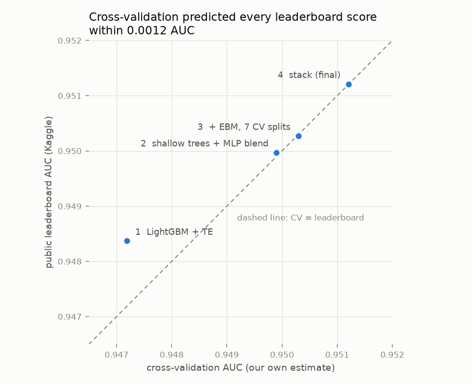

# Credit card fraud detection (Kaggle Playground S6E11)

Predict the probability that a card transaction is fraud, for the Kaggle competition
[Playground Series S6E11](https://www.kaggle.com/competitions/playground-series-s6e11) (700k training rows,
300k test rows, 1.7% fraud). The metric is ROC AUC: how well the model ranks fraud above non-fraud (1.0 = perfect).

**Result:** cross-validated AUC went from 0.9458 (a plain LightGBM baseline) to **0.9512** (final model: a stack
of 8 models). The public leaderboard score of every submission matched its cross-validation (CV) score to within
0.0012. That is why every choice was made on CV, not on the public leaderboard. Final private score: after the
competition closes on 2026-11-30.

## Results

| submission | what changed | CV AUC | public LB |
|---|---|---|---|
| 1 | LightGBM + target encoding of exact values | 0.94719 | 0.94837 |
| 2 | + digit keys, very shallow trees + MLP blend, zone-1 rule | 0.94990 | 0.94997 |
| 3 | + EBM (additive model) in the blend, 7 CV splits | 0.95030 | 0.95027 |
| 4 (final) | + logistic regression on 42 digit keys, logistic-regression stacker | 0.95121 | 0.95121 |



A short walkthrough with figures (column signal, model comparison, where fraud is missed) is in
[notebooks/summary.ipynb](notebooks/summary.ipynb).

The final stack beats submission 3 on every one of 7 CV splits (+0.0009 to +0.0013). A bootstrap 95% interval for
the gain is [+0.00065, +0.00115].

## Approach

1. **Validation first.** 5-fold stratified CV, repeated with 3 and later 7 different splits. Every idea was compared
   on the same splits, and kept only if it won on every split by more than the split-to-split noise (~0.0002 AUC).
2. **Features from data analysis.**
   - Target encoding (the out-of-fold fraud rate) of each column's *exact* value.
   - A velocity residual: velocity score minus its expected value given transaction count and hours.
   - "Digit keys": how a number is written (cents, number of digits, leading digits). These carry signal because
     the data is synthetic and was generated value by value.
3. **Simple models win.** The signal is almost additive, so the best models are very shallow trees (3 leaves),
   an Explainable Boosting Machine and a logistic regression. Deeper trees and CatBoost depth 6 scored lower; RealMLP
   was weaker in a smoke test and too slow for the full data.
4. **Stacking.**
   - A logistic regression combines 8 models' out-of-fold scores. It is evaluated nested, so it is never scored on
     rows it was fit on.
   - One post-processing rule ("zone 1") was checked per fold: merchant risk below 13.1 never had fraud in
     training, so those rows go to the bottom.
5. **No leaderboard fitting.** Public notebooks were read for ideas only (credited in the code). Other people's
   predictions were never blended in, and the data generator script was deliberately not read.

What did not help (all in [EXPERIMENTS.md](EXPERIMENTS.md)):
- the original 20k-row dataset
- deeper or more regularized trees
- specialist models for hard rows
- sample weights
- neural-network input encodings
- extra EBM / MLP variants on top of the final stack

## Repository

```
src/fraud/           shared code: config, data loading, features (target encoding, digit keys), CV, stacking, metric
experiments/         one script per experiment; the final pipeline is listed in reproduce.sh
experiments/archive/ earlier experiments that were dropped (kept so every log entry can be traced to code)
eda/                 exploration scripts, figure and notebook builders
notebooks/           summary.ipynb: the project in 5 short sections with figures
figures/             figures used in this README
outputs/             per-experiment result tables (predictions *.npy and logs are not committed)
EXPERIMENTS.md       every run with its CV and leaderboard score, including failures, plus a glossary
reproduce.sh         rebuilds the final submission from the raw data
```

## Reproduce

```bash
uv venv --python 3.11 .venv && uv pip install --python .venv/bin/python -r requirements.lock
kaggle competitions download -c playground-series-s6e11 -p data/raw && unzip data/raw/*.zip -d data/raw
./reproduce.sh                                                # all 7 CV splits: many hours on a 10-core laptop
FRAUD_OUTPUTS=outputs_repro ./reproduce.sh 42 repro_seed42   # one split (~2 h), as a check
```

- `make_stack_submission` writes a `.manifest.json` next to the submission: the input files with their sha256,
  the stacker weights and the CV score.
- Scripts refuse to overwrite saved predictions or to run with an unknown flag.
- `python -m eda.build_summary_notebook` rebuilds the notebook from the saved predictions (run reproduce.sh first;
  `python -m eda.explain_missed` refits the one EBM it explains).
- Re-running one CV split from scratch (2026-11-27) gave the same CV AUC for all 8 models. EBM, XGBoost, CatBoost
  and the logistic regression matched bit for bit; LightGBM within 1e-14. The final ranking matched to 7e-6
  (`outputs/repro/compare_seed42.csv`).
- The MLP runs on the Apple GPU (MPS), which is not bit-exact: its predictions match to about 1e-5.

## Notes

- Developed with the help of an AI coding assistant.
- Ideas taken from public Kaggle notebooks (plain logistic regression with digit keys, CatBoost depth 2, a stacker
  instead of fixed weights) are credited in the scripts that use them. They were reimplemented on this project's
  own CV splits.
- Competition data is not included (Kaggle rules).
