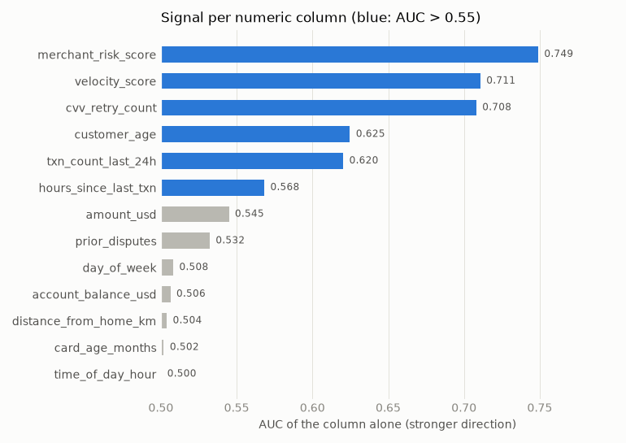
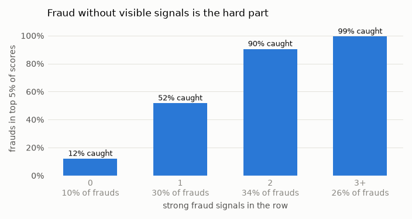
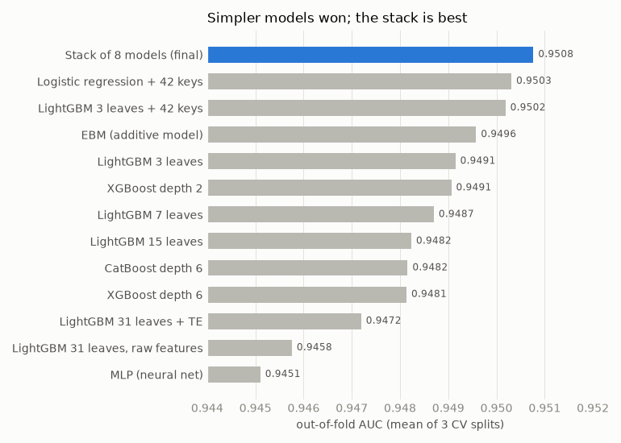

# Which card payments are fraud?

A card company sees hundreds of thousands of payments a day, and fewer than 2 in 100 are fraud. Blocking every
unusual payment would anger good customers; letting fraud through costs money. The useful thing is a score that
puts the fraud at the top of the list, so the few payments worth checking are checked first.

Using a Kaggle competition dataset of 700,000 labelled card payments (synthetic, modelled on real fraud data), I
built such a score. **Flagging the 5% of payments it rates highest catches 73% of all fraud**, and in its top 1%,
two of every three payments are fraud.

## Summary

- **The problem:** give each payment a fraud score, so that fraud ranks above normal payments. The competition
  measures this with AUC: 1.0 is a perfect ranking, 0.5 is a coin flip.
- **The result:** AUC 0.9512, up from 0.9458 for a standard first model. My own validation predicted the Kaggle
  leaderboard score of every submission to within 0.0012.
- **What drives it:** a few clear warning signs (no card authentication, a retried security code, the IP country
  not matching, a risky merchant). Simple models that add up these signs beat complex ones.
- **What it cannot do:** frauds that show none of these signs look like normal payments, and no model I tried
  finds them. Catching those needs data this dataset does not have.

The full walkthrough with figures is in [`notebooks/summary.ipynb`](notebooks/summary.ipynb); every experiment,
including the ones that failed, is in [`EXPERIMENTS.md`](EXPERIMENTS.md).

## The data

Each row is one payment with 25 details: amount, merchant type and its risk score, how the card was checked
(3D Secure, OTP, biometric or nothing), how many payments the card made in the last 24 hours, the customer's age,
and yes/no flags such as "VPN used" or "billing and shipping address differ". 1.7% of the 700,000 training payments
are fraud; the 300,000 test payments are scored by Kaggle.

## What I found first



- **A few signals carry most of the information:** merchant risk, transaction velocity and retried security codes.
  When the IP country does not match the card's, 16.5% of payments are fraud, ten times the average.
- **Some columns carry none:** hour of day, day of week, card age and distance from home are close to a coin flip.
- **How a number is written matters:** the data was generated value by value, so exact values and even their
  digits (cents, number of digits) carry signal. Turning these into features was the biggest single gain.
- **A safe zone:** no payment with a merchant risk score below 13.1 was ever fraud, which I checked on every
  validation fold before using it.

## How I approached it, and why

- **Trust my own validation, not the leaderboard:** every idea was tested on the same 5-fold splits, repeated 3 to
  7 times. The public leaderboard uses only 20% of the test data and is easy to over-fit.
- **Only keep changes that are clearly better:** re-running with a different split moves AUC by about 0.0002, so a
  change had to win on every split by more than that. Most ideas did not.
- **Prefer simple models:** very shallow trees (3 leaves), an additive model (EBM) and a logistic regression beat
  deeper trees and neural networks, because the signal is mostly a sum of separate warning signs.
- **Combine, then check honestly:** the final score is a logistic regression over 8 models, scored only on rows
  none of its parts were trained on.

## Results


| submission | what changed | validation AUC | Kaggle public |
|---|---|---|---|
| 1 | standard model + fraud rate of each exact value | 0.9472 | 0.9484 |
| 2 | + digit features, very shallow trees, a small neural network | 0.9499 | 0.9500 |
| 3 | + additive model (EBM), more validation splits | 0.9503 | 0.9503 |
| **4 (final)** | + logistic regression on 42 digit features, combined by a second model | **0.9512** | **0.9512** |

## Key findings

- **Obvious fraud is caught, quiet fraud is not:** frauds with three or more warning signs are in the top 5% of
  scores 99% of the time; frauds with none, only 12% of the time.

  

- **The missed frauds look normal:** their merchant risk, velocity and age sit close to normal payments, and they
  use 3D Secure about as often as legitimate customers do (34% against 30%). None of the 8 models ranks any of them in its own top 5%.
- **Catching them would be expensive:** where they score, only 0.2-0.6% of payments are fraud, so each extra fraud
  caught would cost 170-480 false alarms.

## How a card issuer could use this

| What the data showed | What an issuer could do |
|---|---|
| In the top 1% of scores, two of three payments are fraud. | Hold or decline these, or ask for extra verification. |
| The top 5% contains 73% of all fraud. | Send this band to step-up checks (OTP) or a review queue. |
| Missing authentication and mismatch flags are the strongest signs. | Require 3D Secure or OTP whenever these flags appear. |
| Missed frauds look like normal payments. | Add data the model lacks: the customer's own spending history, device, merchant fraud reports. |

These are proposals, not measured results: the data is synthetic, and thresholds would have to be tested on real
traffic.

## Lessons learned

- **A validation you can trust saves time:** because my scores matched the leaderboard, I never had to guess.
- **Most ideas do not help:** writing every experiment down, including failures, kept me from keeping lucky ones.
- **Protect your results from yourself:** one mistyped command overwrote saved results; the scripts now refuse to
  overwrite and stop on unknown options.

## Limits

The data is synthetic, so the patterns (especially the digit features) may not exist in real payments. AUC on the
private test set can differ from validation by about ±0.001 by chance alone. The private leaderboard result will be
known after the competition closes on 2026-11-30.

---

## For technical readers

**Kaggle:** public 0.95121 (final submission); private: pending. Every setting was chosen on my own folds, never
from leaderboard feedback. Public notebooks were read for ideas only (credited in the code); no other people's
predictions were blended in. Developed with the help of an AI coding assistant.



- **Validation:** stratified 5-fold, 7 fold seeds; target encoding fitted inside each training fold (inner 5-fold);
  early stopping on a 10% slice of the training fold. The stack's gain over submission 3: +0.0009 to +0.0013 on all
  7 splits, bootstrap 95% CI [+0.00065, +0.00115].
- **Final stack (8 models):** EBM, LightGBM 3 leaves (two feature sets, bagged), XGBoost depth 2, CatBoost depth 2,
  two MLPs, logistic regression with 42 digit keys; logistic-regression stacker (C 0.05), then the zone rule.
- **Reproducibility:** re-running one split from raw data gave identical AUC for all 8 models (4 bit-exact,
  LightGBM within 1e-14, MPS MLP within 1e-5). The final submission has a manifest with the hashes of all its inputs.

### Repository layout

```
src/fraud/          shared code: config, loading, features, CV, stacking, metric
experiments/        the scripts behind the final models (archive/: dropped experiments)
eda/                analysis, figure and notebook builders
notebooks/          summary.ipynb (figures saved in the file)
figures/            charts in this README
outputs/            result tables (predictions are not committed)
EXPERIMENTS.md      every run with its score, a glossary of the short names
reproduce.sh        rebuilds the final submission from the raw data
```

### Setup and running

The competition data cannot be redistributed: accept the rules on the
[competition page](https://www.kaggle.com/competitions/playground-series-s6e11), then:

```bash
uv venv --python 3.11 .venv && uv pip install --python .venv/bin/python -r requirements.lock
kaggle competitions download -c playground-series-s6e11 -p data/raw && unzip data/raw/*.zip -d data/raw
./reproduce.sh                                   # all 8 models x 7 splits + stack: many hours on a laptop
.venv/bin/python -m eda.build_summary_notebook   # rebuild the notebook and figures from saved predictions
```
